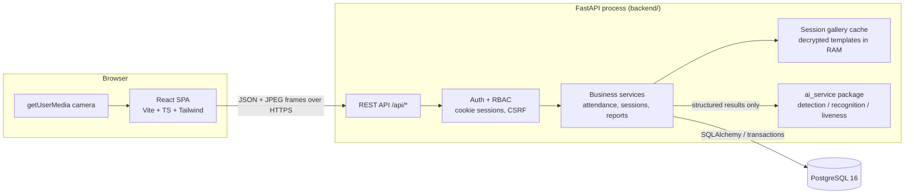
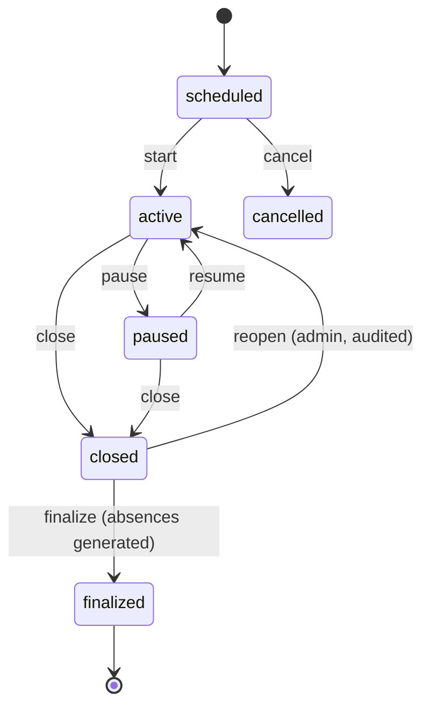

# SmartAttend AI — System Architecture

> Status legend used throughout the docs: **[Implemented]**, **[Experimental]**, **[Planned]**.
> This file is kept consistent with the code; when they disagree, the code wins and this file is a bug.

## 1. Context

SmartAttend AI is a web application that lets an institution record class attendance using
consent-based facial recognition, with manual alternatives and human review for every
uncertain case. It is designed for a single institution, deployed on-premises or on one
cloud VM, and sized to run on a CPU-only laptop (reference machine: Intel i3-1005G1, 8 GB RAM,
no GPU).

## 2. High-level component view



### Why the AI code is a separate package but runs in-process

`ai_service/` is an independent Python package with no imports from `backend/`. It exposes a
small, typed interface (`FaceAnalyzer`, `LivenessDetector`, `match_embedding`) that takes
images/embeddings and returns dataclasses. The backend calls it in-process because:

* On an 8 GB CPU-only machine an extra HTTP hop and a second Python process (each loading
  OpenCV + ONNX Runtime) cost memory and latency without a functional benefit.
* The boundary is still explicit: the AI package never touches the database, never decides
  attendance, and never sees user/session objects. Splitting it into its own microservice
  later only requires wrapping the same interface in an HTTP server. **[Planned]**

## 3. Responsibilities

| Layer | Owns | Must NOT |
|---|---|---|
| Frontend (`frontend/`) | Rendering, camera capture, frame sampling, UX states | Decide identity, attendance status, eligibility, or permissions |
| Backend API (`backend/app/api`) | HTTP, validation (Pydantic), authN/authZ dependencies | Contain SQL or CV logic |
| Services (`backend/app/services`) | Business rules: session state machine, attendance policy, corrections, reports, consent | Trust any client-provided identity/status |
| Repositories / models (`backend/app/models`) | Persistence, constraints, transactions | — |
| AI package (`ai_service/`) | Face detection, quality checks, alignment, embeddings, similarity, liveness | Write to DB, know about courses/sessions |
| PostgreSQL | Durable state, uniqueness (one record per student-session), FK integrity | — |

## 4. Key runtime flows

### 4.1 Live attendance (one sampled frame)

```mermaid
sequenceDiagram
  participant F as Faculty browser
  participant A as FastAPI /api/recognition/recognize
  participant S as AttendanceService
  participant M as ai_service
  participant D as PostgreSQL
  F->>A: POST frame (JPEG) + session_id  [cookie + CSRF]
  A->>A: authN, role check, rate limit, size/type check
  A->>S: process_frame(user, session_id, image)
  S->>D: load session, verify ACTIVE + user owns course
  S->>M: analyze(image) -> faces[bbox, quality, embedding]
  S->>M: liveness(image, bbox) (if policy != off)
  S->>M: match(embedding, session gallery) -> best, score
  S->>S: decide outcome (threshold, margin, liveness policy, cooldown)
  alt recognized + eligible + liveness ok
    S->>D: BEGIN; INSERT attendance_record ON CONFLICT DO NOTHING; INSERT recognition_event; COMMIT
  else uncertain / unknown / failed liveness
    S->>D: INSERT recognition_event (review_status=pending)
  end
  S-->>A: per-face structured outcome (no embeddings)
  A-->>F: 200 JSON; UI shows "Attendance recorded" only if committed=true
```

The raw frame lives only in request memory and is discarded after the response.

### 4.2 Facial enrollment

1. Staff selects a student, or a student opens **My account → Face registration** → backend returns
   consent status for that student only.
2. Consent screen explains purpose, retention, access, deletion; the participant (self-service) or
   staff records informed consent (stored in `biometric_consents`, versioned policy text).
3. Browser opens the camera only after a click. Each preview frame is sent to
   `/api/recognition/detect` for live quality feedback (no storage).
4. 3–5 accepted samples are posted to `/api/enrollment/{student_id}`. Backend re-validates each
   sample server-side, computes embeddings, checks intra-sample consistency and conflicts with
   other students, encrypts embeddings (AES-256-GCM) and stores them. Images are discarded.

### 4.3 Session lifecycle (state machine)



Only `active` sessions accept automated or manual "present/late" marks. Finalization creates
`absent` records for roster members with no record. Post-finalization changes are only possible
through audited corrections.

## 5. Security architecture (summary — see [privacy-security.md](privacy-security.md))

* Argon2id password hashing (argon2-cffi defaults, RFC 9106 low-memory profile).
* Opaque random session token in an `HttpOnly; SameSite=Lax; Secure(prod)` cookie; only its
  SHA-256 hash is stored server-side, so a DB leak does not leak live sessions.
* CSRF: double-submit token (`csrf_token` cookie + `X-CSRF-Token` header) on state-changing requests.
* RBAC enforced by FastAPI dependencies on every route + ownership checks in services.
* Login throttling (per-account lockout + per-IP limiter) and per-route rate limits.
* Biometric templates encrypted at rest with a key from the environment, bound to the student id
  via AEAD associated data; never returned by any API; never logged.
* Audit log for every privileged write with before/after snapshots (no secrets, no embeddings).

## 6. Deployment topology

* **Development (this repo):** portable PostgreSQL 16 under `.tools/` (outside the repo) or any
  local PostgreSQL; `uvicorn` on :8000; Vite dev server on :5173 proxying `/api`.
* **Docker Compose:** `db` (postgres:16), `backend` (uvicorn, runs Alembic on start), `frontend`
  (static build served by nginx, reverse-proxying `/api`). Compose disables `CORS_ORIGINS` because
  the SPA and API share one origin. TLS terminates at an institution gateway in front of the `web`
  container; see [deployment.md](deployment.md).

## 7. Hardware & performance budget

| Step | Expected on i3-1005G1 (CPU) |
|---|---|
| YuNet detection 640×480 | ~10–25 ms |
| SFace embedding per face | ~15–30 ms |
| MiniFASNet liveness per face | ~10–20 ms |
| Frame sampling default | 1 frame / 1000 ms (configurable) |

Numbers above are design estimates, not measurements. Accuracy and latency evidence belongs in
[evaluation.md](evaluation.md) and must come from the `ai_service/evaluation` scripts on an
approved local data set. No such metrics have been measured for this project yet.
