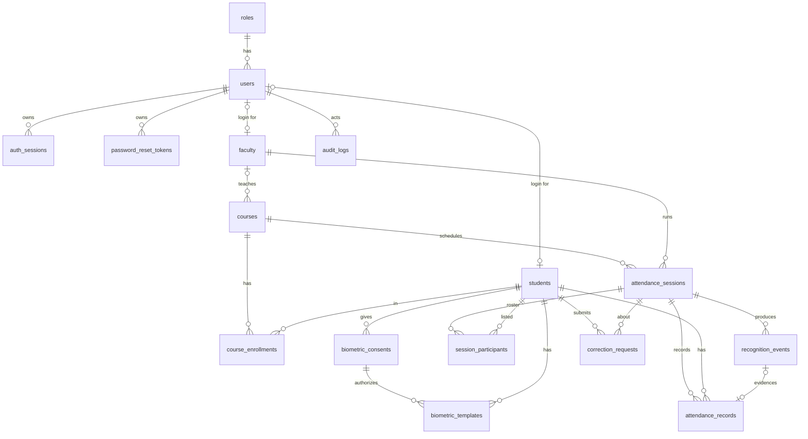

# SmartAttend AI — Database Design (PostgreSQL 16)

All tables are created by Alembic migrations in `backend/migrations/`. The SQLAlchemy models in
`backend/app/models/` are the source of truth; this document describes them.

## 1. Conventions

* Primary keys: `BIGINT GENERATED BY DEFAULT AS IDENTITY` (`roles` uses `SMALLINT`).
* Timestamps: `TIMESTAMPTZ`, always written in UTC. The institution's local timezone
  (`APP_TIMEZONE`, e.g. `Asia/Kolkata`) is used only to interpret "today" and to format dates.
* `created_at` / `updated_at` on every mutable table (`updated_at` maintained by the ORM).
* Enumerations are `VARCHAR` + `CHECK` constraints (portable, migration-friendly) rather than
  native PG enum types.
* Attendance history is never cascaded away: FKs from attendance tables to students/sessions
  use `ON DELETE RESTRICT`. Students and faculty are **deactivated**, never hard-deleted, by the API.
* Biometric data lives only in `biometric_templates` (encrypted) and is the only table that
  cascades on student deletion.

## 2. Entity-relationship diagram



## 3. Tables

### roles
| column | type | notes |
|---|---|---|
| id | smallint PK | 1=admin, 2=faculty, 3=student (seeded by migration) |
| name | varchar(20) UNIQUE | `admin`, `faculty`, `student` |
| description | varchar(200) | |

Fine-grained `permissions` are not needed: authorization is role-based plus ownership checks
(e.g. faculty ↔ assigned course). Configurable exceptions (e.g. "faculty may correct
attendance") live in `application_settings`.

### users
| column | type | notes |
|---|---|---|
| id | bigint PK | |
| email | varchar(254) UNIQUE | stored lower-cased; login identifier |
| full_name | varchar(120) | |
| password_hash | varchar(255) | Argon2id encoded hash |
| role_id | smallint FK→roles | |
| is_active | bool | deactivated users cannot log in; sessions revoked |
| failed_login_attempts | int | reset on success |
| locked_until | timestamptz NULL | temporary lockout after repeated failures |
| last_login_at, password_changed_at | timestamptz NULL | |
| created_at, updated_at | timestamptz | |

### auth_sessions
Opaque session tokens. Only `sha256(token)` is stored.
`id, user_id FK (CASCADE), token_hash char(64) UNIQUE, created_at, expires_at, last_seen_at,
revoked_at NULL, ip_address varchar(45), user_agent varchar(255)`. Index `(user_id)`.

### password_reset_tokens
Admin-issued, single-use, time-limited reset tokens (hash only).
`id, user_id FK (CASCADE), token_hash UNIQUE, expires_at, used_at NULL, created_by_user_id FK NULL, created_at`.

### students
| column | type | notes |
|---|---|---|
| id | bigint PK | internal student ID |
| user_id | bigint FK→users UNIQUE NULL, ON DELETE SET NULL | portal account |
| registration_number | varchar(32) UNIQUE | institution-issued |
| full_name | varchar(120) | |
| email | varchar(254) UNIQUE | |
| department | varchar(80) | indexed |
| program | varchar(80) | "Course / class" (e.g. `B.Tech CSE 2023 – A`), indexed |
| enrollment_year | smallint | CHECK 1990–2100 |
| status | varchar(16) | `active`, `inactive`, `graduated`, `suspended`; indexed |
| deactivated_at | timestamptz NULL | starts the biometric retention clock |
| created_at, updated_at | | |

### faculty
`id, user_id FK UNIQUE NULL, employee_id varchar(32) UNIQUE, full_name, email UNIQUE,
department (idx), designation, status (active|inactive), created_at, updated_at`.

### courses
`id, code varchar(20) UNIQUE, name, department (idx), term varchar(20), faculty_id FK→faculty NULL
(ON DELETE SET NULL, idx), status (active|archived), created_at, updated_at`.

### course_enrollments
`id, course_id FK RESTRICT, student_id FK RESTRICT, status (active|dropped), enrolled_at,
dropped_at NULL`. **UNIQUE(course_id, student_id)**; index `(student_id)`.

### biometric_consents
One row per consent grant. Withdrawal updates the row (`status='withdrawn'`, `withdrawn_at`).
`id, student_id FK RESTRICT (idx), status (granted|withdrawn), policy_version varchar(20),
capture_method (staff_assisted|self_service), recorded_by_user_id FK NULL, granted_at,
withdrawn_at NULL, withdrawal_reason NULL, created_at, updated_at`.
Partial unique index: at most one `granted` consent per student.

### biometric_templates (sensitive)
| column | type | notes |
|---|---|---|
| id | bigint PK | |
| student_id | FK→students ON DELETE CASCADE, idx | |
| consent_id | FK→biometric_consents RESTRICT | template cannot exist without consent |
| model_name | varchar(60) | e.g. `opencv-sface` |
| model_version | varchar(40) | e.g. `2021dec` |
| embedding_dim | smallint | 128 for SFace |
| ciphertext | bytea | AES-256-GCM(embedding float32 bytes) |
| nonce | bytea(12) | unique per row |
| key_id | varchar(20) | supports key rotation |
| quality | jsonb | blur/brightness/face-size of the sample (no pixels) |
| created_by_user_id | FK NULL | |
| created_at | timestamptz | |

AEAD associated data = `"smartattend:template:{student_id}:{model_name}:{model_version}"` so a
ciphertext copied to another student's row fails to decrypt. No API returns this table's
ciphertext or embeddings. No raw images are stored anywhere.

### application_settings
`key varchar(60) PK, value jsonb, updated_by_user_id FK NULL, updated_at`. Seeded defaults:

| key | default | meaning |
|---|---|---|
| recognition_threshold | 0.42 | SFace cosine threshold (design default; re-select on validation data, see [evaluation.md](evaluation.md)) |
| low_confidence_margin | 0.07 | scores in `[threshold − margin, threshold)` → `low_confidence` (review) |
| ambiguity_margin | 0.05 | if best − second-best < margin → `low_confidence` |
| liveness_policy | `"off"` | `off` \| `flag` (record, review if not passed) \| `enforce` (block unless passed) |
| liveness_threshold | 0.80 | MiniFASNet "real" probability to pass; below 0.5 fails; between = inconclusive |
| frame_interval_ms | 1000 | client frame sampling period |
| recognition_cooldown_s | 30 | suppress repeat events for same person/session |
| max_faces_per_frame | 5 | more → `multiple_faces` outcome |
| min_face_px | 80 | minimum face box side |
| blur_threshold | 60.0 | variance of Laplacian on the face crop |
| brightness_min / brightness_max | 50 / 210 | mean grey level of face crop |
| default_late_after_min | 10 | minutes after start → `late` |
| default_window_min | 30 | minutes after start during which automated marking allowed |
| faculty_can_correct | true | faculty may correct records of own courses |
| biometric_retention_days | 30 | templates purged N days after student deactivation |

### attendance_sessions
| column | type | notes |
|---|---|---|
| id | bigint PK | |
| course_id | FK RESTRICT, idx | |
| faculty_id | FK→faculty RESTRICT, idx | |
| title | varchar(120) | |
| session_date | date | institution-local date, idx |
| scheduled_start, scheduled_end | timestamptz | CHECK end > start |
| late_after | timestamptz | marks after this → `late` |
| attendance_closes_at | timestamptz | no automated marks after this; CHECK start ≤ late_after ≤ closes_at |
| status | varchar(12) | `scheduled`,`active`,`paused`,`closed`,`finalized`,`cancelled`; idx |
| liveness_policy | varchar(8) | snapshot of the setting when the session is created |
| started_at, closed_at, finalized_at | timestamptz NULL | |
| created_by_user_id | FK NULL | |
| created_at, updated_at | | |

### session_participants (eligible roster snapshot)
`id, session_id FK CASCADE, student_id FK RESTRICT, added_at`. **UNIQUE(session_id, student_id)**.
Populated from active `course_enrollments` when the session is created. Enrolling or dropping a
student on the course also updates its open sessions (`scheduled`, `active`, `paused`); closed,
cancelled and finalized rosters stay fixed so historical attendance remains explainable.

### recognition_events
One row per analysed face that leads to a decision (cooldown-suppressed repeats are not stored).
| column | notes |
|---|---|
| id, session_id FK RESTRICT NULL (idx), operator_user_id FK NULL, occurred_at (idx) | |
| outcome | `recognized`,`unknown`,`low_confidence`,`poor_quality`,`no_face`,`multiple_faces`,`liveness_failed`,`duplicate`,`not_eligible`,`error` |
| matched_student_id FK NULL | set for `recognized`/`duplicate` and for a confidently matched but ineligible student (`not_eligible`); reviewers only |
| candidate_student_id FK NULL | best candidate for `low_confidence` — visible to reviewers only |
| similarity, second_similarity, threshold_used | real NULL |
| detector_score | real NULL |
| quality | jsonb (blur, brightness, face_px) |
| liveness_status | `not_required`,`not_enabled`,`passed`,`failed`,`inconclusive`,`error` |
| liveness_score, liveness_model | NULL-able |
| model_name, model_version | recognition model provenance |
| processing_ms | int |
| review_status | `not_required`,`pending`,`resolved`,`dismissed` (idx) |
| reviewed_by_user_id, reviewed_at, review_note | |
| error_code | varchar(40) NULL |

### attendance_records
| column | notes |
|---|---|
| id, session_id FK RESTRICT, student_id FK RESTRICT | **UNIQUE(session_id, student_id)** — the hard duplicate guard |
| status | `present`,`late`,`absent`,`pending_review`,`excused` |
| source | `automated` (recognition), `manual` (staff), `system` (finalization absences) |
| marked_at | timestamptz |
| recognition_event_id | FK NULL (SET NULL) — liveness outcome is on the referenced event |
| marked_by_user_id | FK NULL |
| reviewer_id, correction_reason, corrected_at | latest correction (full history in audit_logs) |
| created_at, updated_at | |

### correction_requests
`id, student_id FK, session_id FK, attendance_record_id FK NULL, request_type
(correction|manual_attendance), requested_status (present|late|excused), reason text,
status (pending|approved|rejected|withdrawn), reviewer_id NULL, reviewed_at NULL,
reviewer_note NULL, created_at, updated_at`. Partial unique index: one `pending` request per
(student_id, session_id).

### audit_logs (append-only)
`id, occurred_at (idx), actor_user_id FK NULL (idx), actor_role, action varchar(60) (idx),
entity_type varchar(40), entity_id varchar(40), before jsonb NULL, after jsonb NULL, reason text NULL,
ip_address, request_id`. Index `(entity_type, entity_id)`. Never contains passwords, tokens or
embeddings — the audit helper strips known sensitive keys.

## 4. Concurrency & transactions

Automated attendance:

```sql
INSERT INTO attendance_records (session_id, student_id, status, source, ...)
VALUES (...)
ON CONFLICT (session_id, student_id) DO NOTHING
RETURNING id;
```

If no row is returned the request was a duplicate (possibly a concurrent one) and the event is
stored with outcome `duplicate`. Event + record are written in one transaction, so the UI is only
told "recorded" after `COMMIT`. Session state transitions use `SELECT … FOR UPDATE` on the
session row.

## 5. Attendance percentage definition

```
attended  = count(records with status in {present, late})
eligible  = count(finalized sessions where student is on the roster) − count(excused)
attendance % = attended / eligible × 100   (undefined → shown as "—" when eligible = 0)
```

Sessions that are not yet finalized are excluded from percentages (their records are shown as
provisional in history). `pending_review` records in finalized sessions count as not attended
until resolved.

## 6. Initialization

```
cd backend
alembic upgrade head                 # schema + roles + default settings
python -m app.cli seed-admin         # dev-only admin (reads password from env or prompts)
python -m app.cli seed-demo          # optional fictional demo data (dev only)
python -m app.cli purge-biometrics --dry-run   # templates past retention (ops)
python -m app.cli purge-biometrics --yes       # actually purge, audited
```
