# SmartAttend AI — Diagram Pack

All diagrams are Mermaid and render on GitHub, GitLab, VS Code and most Markdown viewers. They
describe the **as-built** system. The ER diagram is a summary; the full schema is in
[database-design.md](database-design.md). Requirements IDs refer to [srs.md](srs.md).

## 1. System context

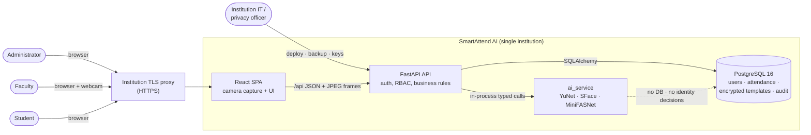

No biometric data leaves the deployment. The only external artefacts are the downloaded,
checksum-verified model files.

## 2. Actors and use cases

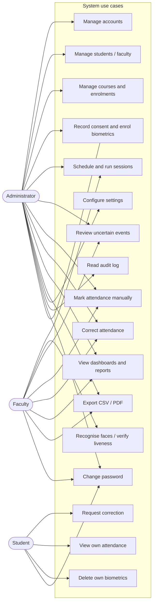

Faculty actions are limited to their own courses; student actions are limited to their own records.
Students may read their own profile and biometric status, but never galleries or review queues.

## 3. Container and component view

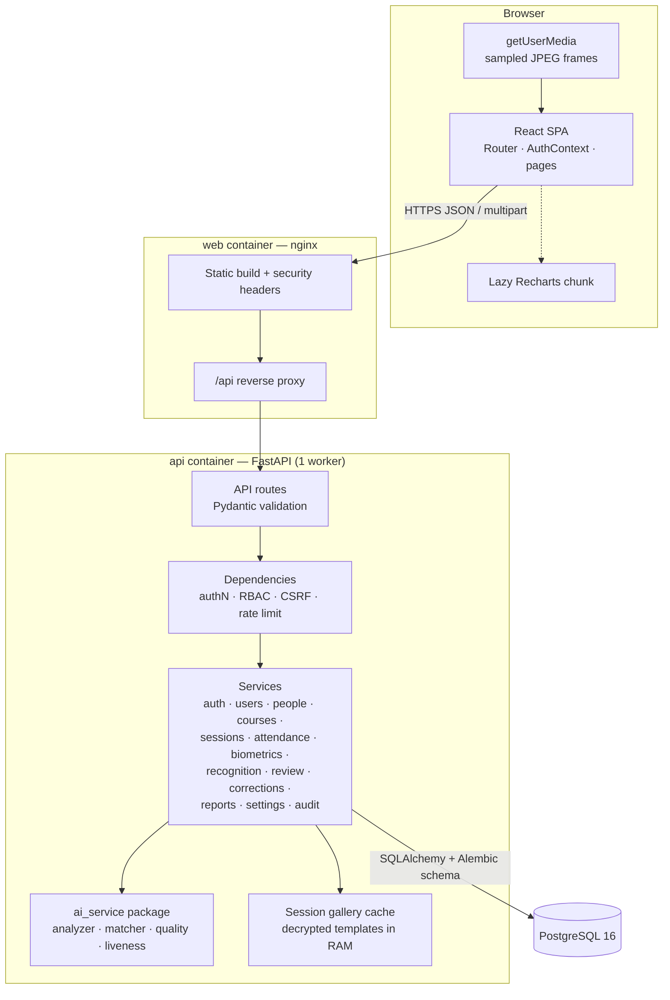

The browser never decides identity, eligibility or attendance status. `ai_service` never imports
backend code and never touches the database.

## 4. Deployment topology

### 4.1 Local development (no Docker)

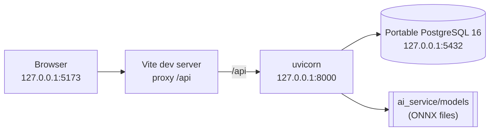

### 4.2 Docker Compose production

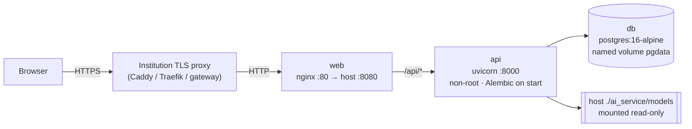

Only `web` publishes a host port. API and database are unreachable from outside the Compose
network. See [deployment.md](deployment.md).

## 5. Entity-relationship summary

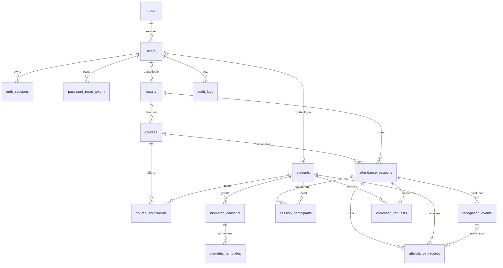

Key invariants: `UNIQUE(course_id, student_id)` on enrolments, `UNIQUE(session_id, student_id)` on
attendance, at most one `granted` consent per student, at most one pending correction per
student/session, and `ON DELETE RESTRICT` from history to people/sessions.

## 6. Sequence diagrams

### 6.1 Sign-in, session and CSRF

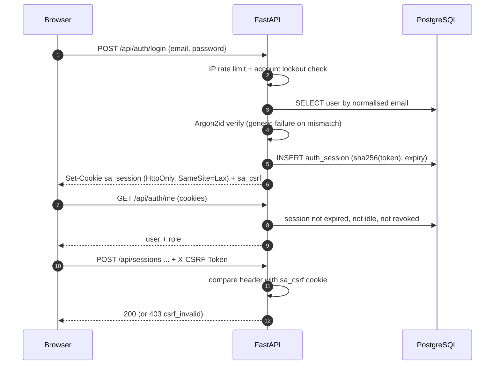

Passwords and raw session tokens are never logged. Only the token hash is stored.

### 6.2 Consent and biometric enrolment

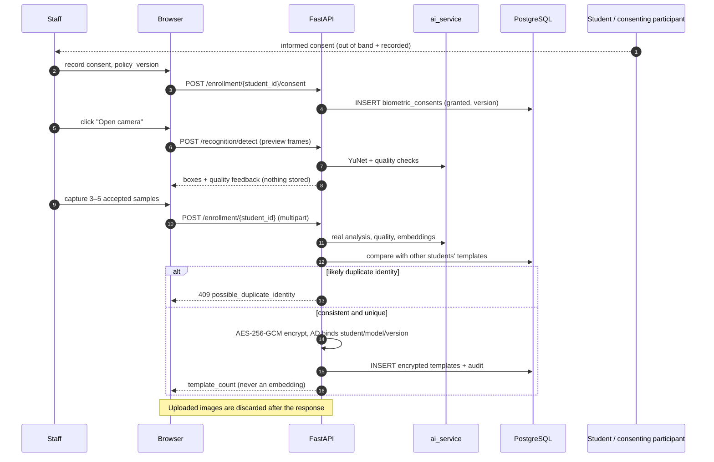

### 6.3 Live recognition and liveness

```mermaid
sequenceDiagram
  autonumber
  participant F as Faculty browser
  participant A as FastAPI
  participant R as RecognitionService
  participant AI as ai_service
  participant D as PostgreSQL

  F->>A: POST /recognition/recognize (frame, session_id, CSRF)
  A->>R: authN + ownership + rate limit + size/type
  R->>D: session must be active; load roster gallery
  R->>AI: detect + quality + embedding
  R->>AI: match against gallery (max cosine/student)
  alt liveness policy != off
    R->>AI: MiniFASNet score for each face
  end
  alt confidently matched, eligible, liveness OK
    R->>D: BEGIN; INSERT attendance ON CONFLICT DO NOTHING;<br/>INSERT recognition_event; COMMIT
    R-->>F: outcome=recognized, attendance.committed=true
  else low confidence / ambiguous / not eligible
    R->>D: INSERT recognition_event (review pending or metadata)
    R-->>F: low_confidence | not_eligible — no attendance
  else liveness failed / inconclusive
    alt policy=flag
      R->>D: attendance + event pending review
      R-->>F: recorded, flagged for review
    else policy=enforce
      R->>D: event only (liveness_failed / error)
      R-->>F: not marked
    end
  end
  Note over F,R: The raw frame is discarded after the response
```

### 6.4 Review of an uncertain event

```mermaid
sequenceDiagram
  autonumber
  participant F as Faculty / admin
  participant A as FastAPI
  participant D as PostgreSQL

  F->>A: GET /recognition/events?status=pending
  A-->>F: candidates (low confidence / liveness / multiple faces)
  F->>A: POST /recognition/events/{id}/resolve {action, note}
  A->>D: SELECT event FOR UPDATE; must be pending
  alt mark_present / mark_late
    A->>D: create or update attendance + audit + resolved
  else dismiss
    A->>D: event resolved/dismissed + audit (record unchanged)
  end
  A-->>F: resolved event
```

### 6.5 Student correction request and approval

```mermaid
sequenceDiagram
  autonumber
  participant S as Student
  participant F as Faculty / admin
  participant A as FastAPI
  participant D as PostgreSQL

  S->>A: POST /corrections {session_id, requested_status, reason}
  A->>D: own session; no pending request; insert pending
  F->>A: POST /corrections/{id}/reject {note}
  A->>D: status=rejected + audit; attendance unchanged
  Note over S,D: A rejected request never changes attendance
  F->>A: POST /corrections/{id}/approve {note}
  A->>D: BEGIN; upsert attendance; audit before/after;<br/>status=approved; COMMIT
  A-->>F: updated record
```

### 6.6 Report query and export

```mermaid
sequenceDiagram
  autonumber
  participant U as Staff browser
  participant A as FastAPI
  participant D as PostgreSQL

  U->>A: GET /reports/attendance?type=...&filters
  A->>A: validate dates/type/granularity; derive scope
  A->>D: aggregate attendance rows within scope
  A-->>U: columns + rows + summary (paged)
  U->>A: GET /reports/export?same filters&fmt=csv|pdf
  A->>D: same query, cap 10,000 rows
  alt CSV
    A->>A: neutralise = + - @ tab CR prefixes
  else PDF
    A->>A: reportlab landscape A4
  end
  A-->>U: attachment (Content-Disposition)
```

## 7. State machines

### 7.1 Attendance session

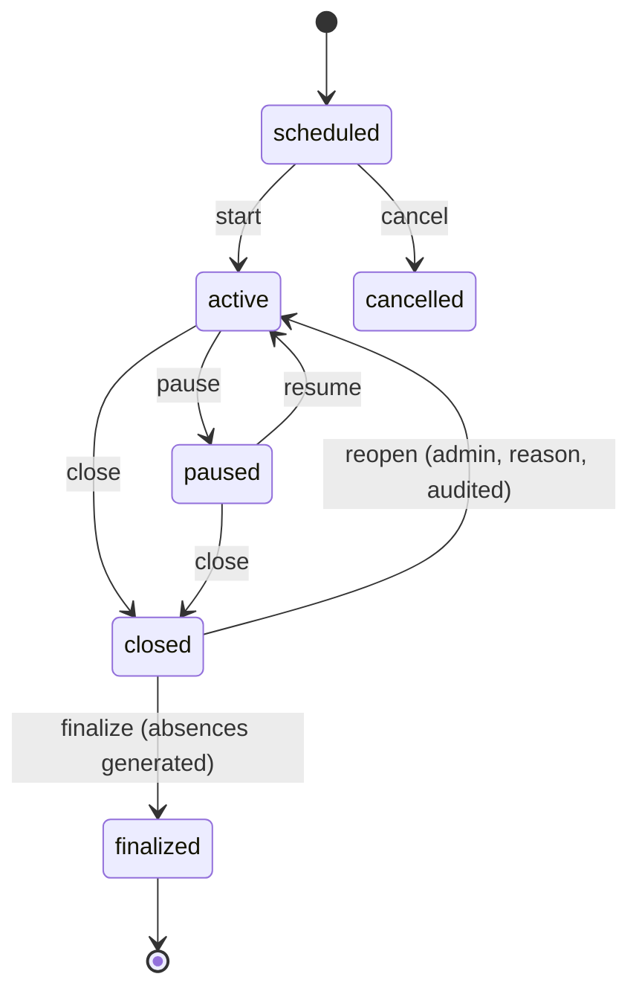

Automated and manual present/late marks are accepted only while `active`. Finalisation is
idempotent; later changes require an audited correction.

### 7.2 Recognition event review

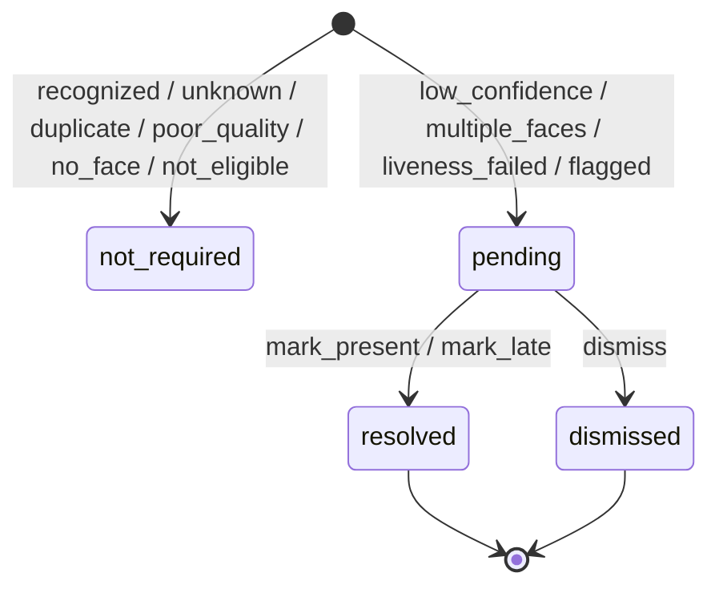

Resolving twice is rejected with `409 already_reviewed`. Dismissal leaves attendance untouched.

### 7.3 Correction request

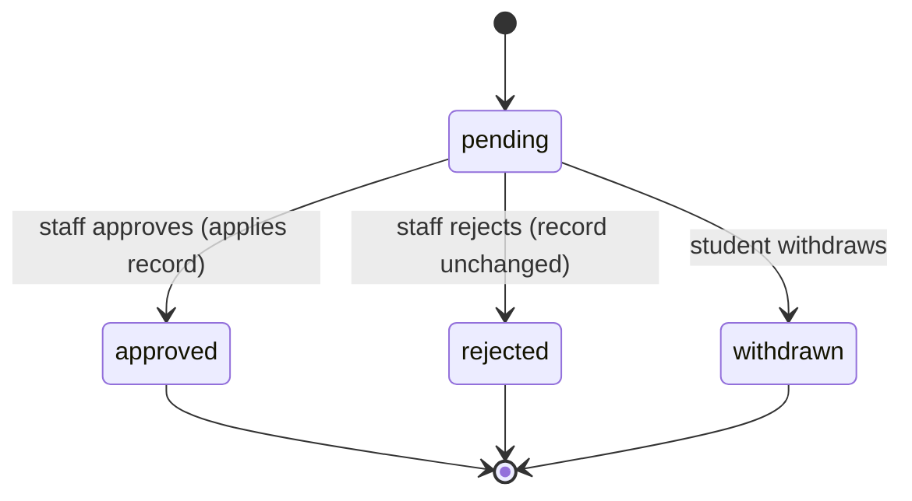

### 7.4 Liveness policy (per session snapshot)

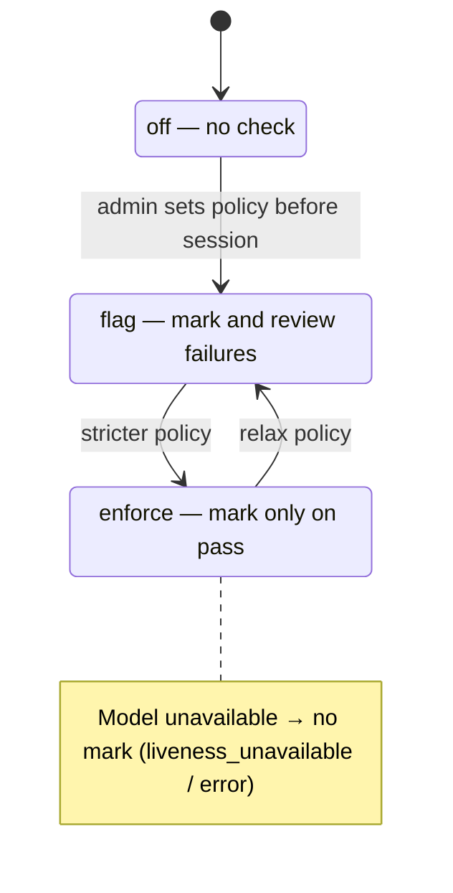

The policy is copied into the session when it is created, so mid-session setting changes do not
retroactively alter an ongoing session.

## 8. Privacy data flow for a single frame

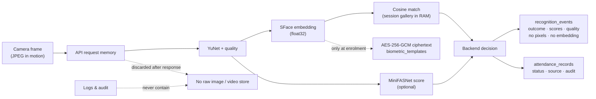

## 9. Diagram-to-requirement map

| Diagram | Primary requirements |
|---|---|
| Context, container view | NFR-DEP-02/03, NFR-SEC-01/08, C3/C4 |
| Use cases | AUTH, USR, PPL, CRS, BIO, SES, REC, REV, COR, RPT, AUD |
| Deployment | NFR-DEP-01/02/03/04, NFR-SEC-07 |
| ER summary | Database invariants, NFR-REL-01/02, NFR-PRV-02/03 |
| Sign-in sequence | AUTH-01…06, NFR-SEC-02/03 |
| Enrolment sequence | BIO-01…08, NFR-PRV-01/02 |
| Recognition sequence | REC-01…12, NFR-REL-04 |
| Review sequence | REV-01…05, NFR-REL-01 |
| Correction sequence | COR-01…04, AUD-01/02 |
| Report sequence | RPT-01…06, NFR-PERF-04, NFR-SEC-06 |
| Session / review / correction states | SES-01…06, REV-02, COR-01…04 |
| Privacy flow | C4/C5, NFR-PRV-02/05, NFR-SEC-05 |
