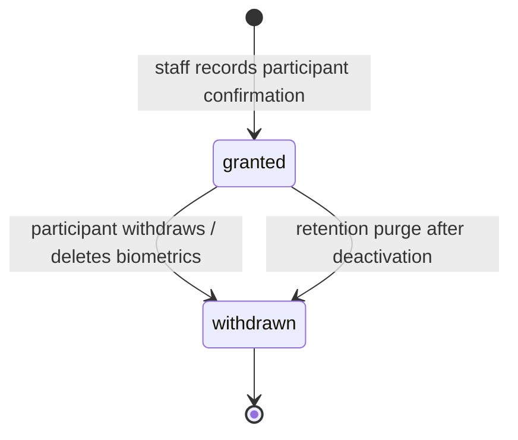

# Privacy and Security Design

This document is the operational privacy/security summary referenced by
[architecture.md](architecture.md) and the SRS. It describes what the code does; it is **not** a
legal opinion or a certification. The deploying institution remains responsible for its lawful
basis, notice, retention policy, and any regulatory obligations (for example India's DPDP Act,
GDPR, or local education rules).

## 1. Principles applied

1. **Consent before biometrics.** Templates cannot be created without a recorded, versioned consent.
2. **Data minimisation.** Only embeddings and non-identifying quality numbers are stored; raw frames
   and enrolment images are discarded after the response.
3. **Purpose limitation.** Recognition is used only to mark attendance for a scheduled session; the
   system is not a surveillance or proctoring tool.
4. **Human control.** Uncertain matches and failed liveness checks never become attendance without a
   staff decision.
5. **Least privilege.** Students see only their own data; faculty only their own courses; administrators
   have account/settings/audit access but cannot recover encryption keys.
6. **Defence in depth.** Server-side RBAC, CSRF, session expiry, rate limits, encryption at rest,
   security headers and audit logging.
7. **Honesty.** Liveness is labelled experimental; missing models produce explicit unavailability,
   never a simulated pass; accuracy metrics are not published until measured.

## 2. Data inventory

| Data | Stored where | Retention / deletion | Notes |
|---|---|---|---|
| Account details, Argon2id hash | `users` | Account lifetime; deactivation keeps history | No plaintext password ever stored |
| Session token | Browser cookie + `auth_sessions.token_hash` | TTL 480 min, idle 60 min, revoked on logout/deactivate/reset | Raw token is never stored server-side |
| Reset token | `password_reset_tokens.token_hash` | 24 h, single use | Link displayed once to an administrator |
| Consent record | `biometric_consents` | Kept for accountability; status updated on withdrawal | Versioned policy text |
| Facial templates | `biometric_templates.ciphertext` | Until deletion/withdrawal; purged 30 days after deactivation (configurable) | AES-256-GCM, 128-float embeddings only |
| Attendance, sessions, rosters | Attendance tables | Institutional policy; history is not cascaded away | No biometrics in these tables |
| Recognition metadata | `recognition_events` | Institutional policy | Outcome, scores, quality numbers, model provenance |
| Audit log | `audit_logs` | Institutional policy (append-only) | Never contains secrets or embeddings |
| Raw camera frames | Request memory only | Discarded after the response | Never written to disk, DB, logs or cache |
| Evaluation images/scores | Outside the repository, if used | Delete after evaluation | Never committed or baked into images |

The `purge-biometrics` maintenance command deletes templates for students deactivated longer than the
configured retention period and withdraws their consent:

```bash
python -m app.cli purge-biometrics --dry-run
python -m app.cli purge-biometrics --yes
```

Schedule the second command (for example a protected cron job) and keep its output free of names,
emails and template data. The command prints counts only.

## 3. Consent lifecycle



* Enrolment requires `participant_confirmed: true` and the current `policy_version`; stale versions
  are rejected so the participant always agrees to current wording.
* Students can record consent and enrol their own face from **My account → Face registration**.
  Self-service consent is stored with `capture_method: self_service`; staff-assisted enrolment uses
  `staff_assisted`. A student cannot read or change another student's biometric status.
* Withdrawal prevents further matching; the API offers template deletion. Attendance history remains
  because it is institutional academic data, not biometric data.
* The institution must provide an accessible notice covering purpose, voluntary nature,
  alternatives, recipients, retention, risks, and the right to withdraw. The text in
  `biometric_policy.py` is a template, not legal advice.

## 4. Template protection

* Embeddings are encrypted with **AES-256-GCM**; a fresh 96-bit nonce is generated per template.
* Associated data binds the ciphertext to
  `smartattend:template:{student_id}:{model_name}:{model_version}`. Copying a row to another
  student or model causes decryption to fail.
* Keys come from `BIOMETRIC_ENCRYPTION_KEYS` (`key_id:base64(32 bytes)`, comma-separated). The first
  key encrypts new templates; all listed keys can decrypt, enabling rotation.
* Keys must be backed up separately from database backups. If every key is lost, templates cannot be
  read and students must re-enrol. If keys and database are stolen together, templates are exposed;
  encrypt backups and restrict key access.
* Decrypted templates exist only in process memory for the duration of a recognition session
  gallery. They are never returned by an API or written to logs.

## 5. Access control matrix

| Action | Admin | Faculty (own course) | Student (self) | Unauthenticated |
|---|---|---|---|---|
| View own profile / change password | ✓ | ✓ | ✓ | — |
| Manage users, settings, audit | ✓ | — | — | — |
| Manage students/faculty/courses | ✓ | read own course | — | — |
| Record consent / enrol / delete templates | ✓ | — | ✓ (own record only) | — |
| Create/start/close sessions | ✓ | ✓ | — | — |
| Run recognition | ✓ | ✓ | — | — |
| Review events / manual marks / corrections | ✓ | ✓ | — | — |
| Request correction | — | — | ✓ | — |
| View attendance history | all | own courses | own | — |
| Reports / exports | all | own courses | — | — |
| Health endpoint | public (no secrets) | public | public | public |

The UI hides unavailable navigation, but the API enforces these rules independently. Forbidden
resources return `404` where revealing existence would itself leak information.

## 6. Authentication and session security

* **Argon2id** password hashing via `argon2-cffi`; password strength is validated on creation,
  change and reset.
* Opaque 256-bit session tokens; only SHA-256 hashes stored. Cookie:
  `HttpOnly`, `SameSite=Lax`, `Secure` when `COOKIE_SECURE=true` (mandatory with HTTPS).
* Absolute and idle expiry; logout, password change, reset, account deactivation and retention-related
  account changes revoke sessions.
* CSRF double-submit: `sa_csrf` cookie + `X-CSRF-Token` header. Login/reset are exempt because no
  session exists yet; they are still rate-limited.
* Account lockout after repeated failures plus per-IP rate limits; login responses do not disclose
  whether an account exists.
* Session tokens and passwords are never logged; audit snapshots strip sensitive keys.

## 7. Threat model and mitigations

| Threat | Mitigation | Residual risk |
|---|---|---|
| Spoofed photo/screen at the camera | Optional MiniFASNet `flag`/`enforce`; staff supervision; absence of a pass never marks | **High** — single-frame RGB PAD is experimental; high-quality replay may pass |
| Wrong identity matched | Conservative threshold, ambiguity margin, low-confidence review, no auto-mark for uncertainty | False accepts/rejects exist; accuracy not measured |
| Student impersonation by a classmate | Liveness signal + staff presence + audit trail | Not eliminated; no exam-grade identity proofing |
| Credential stuffing / brute force | Argon2id, lockout, IP rate limit, generic errors, session revocation | Distributed attacks; no MFA (out of scope) |
| CSRF | Double-submit token on all state-changing routes | XSS would defeat it; CSP reduces XSS |
| XSS | React escaping, strict CSP, no `dangerouslySetInnerHTML`, JSON APIs | Third-party dependency compromise |
| Session theft | HttpOnly/Secure cookies, server-side revocation, idle timeout | Malware on the client |
| Database theft | Encrypted templates with AAD; hashed tokens/passwords | Attendance/user metadata is not encrypted at rest |
| Key loss | Documented backup requirement | Re-enrolment required |
| Insider misuse | Role scoping, audit log, no gallery API, reviewer-only candidates | Administrators with DB/key access are highly privileged |
| Log leakage | Sensitive-key stripping, no raw frames/embeddings in logs | Application bugs must be reviewed |
| Spreadsheet formula injection | CSV cells prefixed with `'` when starting with `= + - @` tab/CR | User-opened files still need care |
| Denial of service | Upload limits, rate limits, body size at nginx | Single-process limiter; no WAF |
| Model supply-chain tampering | SHA-256 verification in `fetch_models.py`, pinned licences | Host compromise |

## 8. Logging and audit

* Audit entries record actor, role, action, entity, before/after snapshots, reason, IP and request id
  for privileged writes: user/account changes, student/faculty lifecycle, enrolment/consent/deletion,
  session reopen, manual attendance, review resolution, corrections, settings.
* Passwords, tokens, embeddings, ciphertext and raw images are excluded. The audit helper strips
  known sensitive keys; reviewers must still avoid putting sensitive prose in free-text reasons.
* Application logs are operational (startup, errors, liveness unavailability) and do not include
  biometric payloads. Access logs may contain IP addresses; treat them as personal data.
* Audit records are append-only through the application; DB-level tamper evidence is not implemented
  (a DBA can modify rows). Institutional controls should restrict DB access and retain external
  backups.

## 9. Deployment hardening checklist

- [ ] HTTPS terminated before `web`; `PUBLIC_URL` is the real origin; `COOKIE_SECURE=true`.
- [ ] `BIOMETRIC_ENCRYPTION_KEYS` generated with a CSPRNG and backed up separately.
- [ ] `POSTGRES_PASSWORD` URL-safe and unique; database not published to the host.
- [ ] Only the web port is exposed; firewall restricts administrative access.
- [ ] Model files checksum-verified; evaluation data and `.env` are outside images/version control.
- [ ] Backups tested (restore into a scratch database) and encrypted.
- [ ] Retention job (`purge-biometrics`) scheduled and monitored.
- [ ] Audit review and access review performed periodically.
- [ ] Incident plan covers key compromise, database exposure and camera-station misuse.

## 10. Data-subject requests and incident response

* **Access:** students can view their attendance and biometric status in the portal.
* **Correction:** students submit correction requests for attendance; account/biometric data
  corrections go through the administrator.
* **Deletion:** students can delete their own templates; attendance history is handled under
  institutional academic-record rules, not erased silently.
* **Incident steps:** contain (revoke sessions, disable accounts, rotate keys), assess scope without
  copying biometric data, preserve audit logs, notify per institutional policy/law, remediate,
  document lessons. Key rotation requires re-encrypting existing templates; no automatic re-wrap tool
  is included, so plan a re-enrolment or migration before rotating the only key.

## 11. Known privacy/security limitations

* No MFA, SSO, tenant isolation or field-level encryption of attendance metadata.
* No database-level audit immutability or tamper-evident logging.
* In-process rate limiting/cooldown assumes one API worker.
* Liveness is experimental and not certified; it must not be the sole basis for high-stakes decisions.
* Demographic bias and PAD robustness are unmeasured; a human review path is mandatory for
  uncertainty.
* The project does not implement automated DSAR workflows, breach notification, or consent-expiry
  re-prompting.
